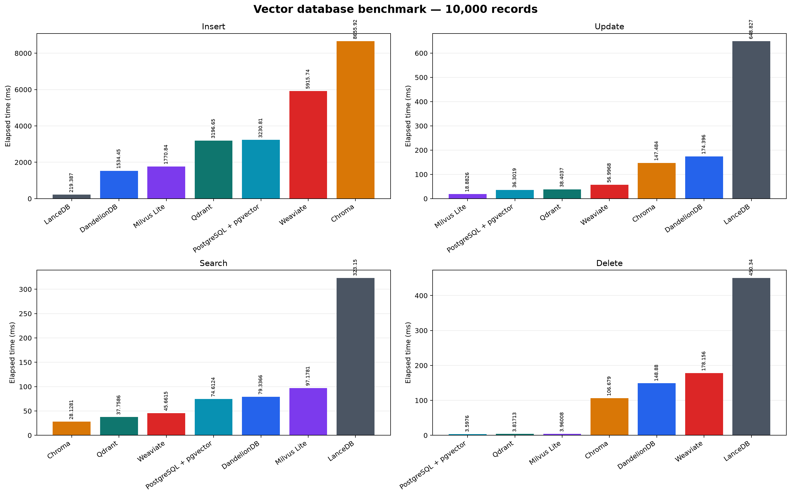

# Vector database benchmark

This project compares vector database performance using the same precomputed text embeddings and the same CRUD/search workload.

## Dataset

- Source: AG News dataset
- Records: 10,000
- Text field: news article title and description
- Embedding model: `all-MiniLM-L6-v2`
- Embedding dimensions: 384
- Similarity metric: cosine
- Input format: JSONL records containing `id`, `text`, and `embedding`

Embeddings are generated outside the timed benchmark path with:

```powershell
docker compose run --rm embedder
```

## Databases

The benchmark includes:

- DandelionDB
- Qdrant
- Chroma
- Milvus Lite
- Weaviate
- PostgreSQL with pgvector
- LanceDB

Qdrant, Chroma, Weaviate, and PostgreSQL run as Docker services. Milvus Lite and LanceDB run inside the benchmark container in embedded mode.

## Benchmark method

Each database receives the same 10,000 records and runs these operations in order:

1. Insert all records in batches of 1,000.
2. Update every 100th record, for 100 updates.
3. Search using the first 10 dataset vectors with `top-k = 10`.
4. Delete every 100th record, for 100 deletes.

The benchmark records elapsed time and average time per item. Database setup, schema creation, dataset loading, and embedding generation are outside the timed operations.

Search correctness is verified against brute-force cosine similarity computed from the source vectors. The latest run returned 100/100 expected IDs with zero mismatches for every database.

Run the Docker databases and benchmark with:

```powershell
docker compose up -d qdrant chroma weaviate postgres
docker compose run --rm remote-benchmark
docker compose down
```

Run DandelionDB natively with:

```powershell
cargo run --release -- run --backend dandeliondb --data data/benchmark.jsonl --batch-size 1000 --search-queries 10 --top-k 10 --output results/dandeliondb-results.csv --db-path results/dandeliondb.lion
```

## Latest results

Elapsed times for the 10,000-record run, sorted fastest to slowest within each operation:

| Database | Insert (ms) | Update (ms) | Search (ms) | Delete (ms) |
|---|---:|---:|---:|---:|
| DandelionDB | 1534.4523 | 174.3961 | 79.3366 | 148.8801 |
| Qdrant | 3196.649095 | 38.403694 | 37.758646 | 3.817127 |
| Chroma | 8655.917985 | 147.483587 | 28.128080 | 106.678894 |
| Milvus Lite | 1770.836101 | 18.882561 | 97.178104 | 3.960079 |
| Weaviate | 5915.739882 | 56.996837 | 45.661533 | 178.156093 |
| PostgreSQL + pgvector | 3230.812506 | 36.301885 | 74.612379 | 3.597597 |
| LanceDB | 219.386696 | 648.827375 | 323.149849 | 450.339935 |



Detailed CSV results are preserved in `results/dandeliondb-results.csv` and `results/remote-results.csv`. The generated database files and all historical result files remain in `results/` and are excluded from Git by `.gitignore`.
